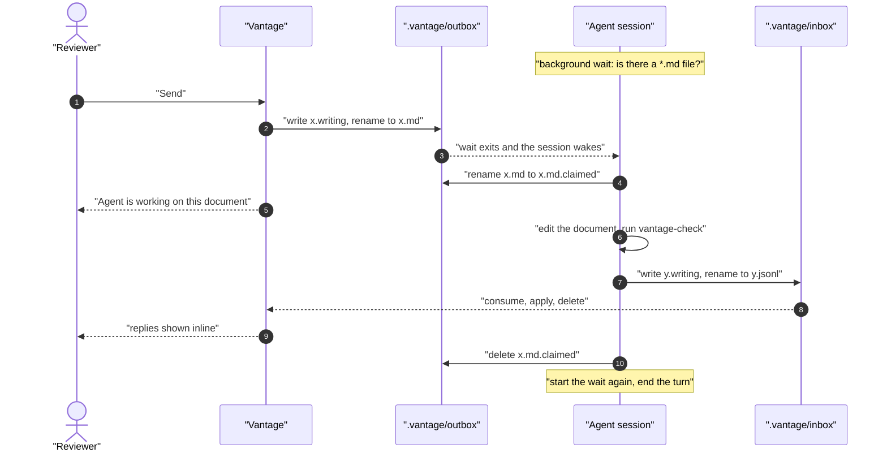
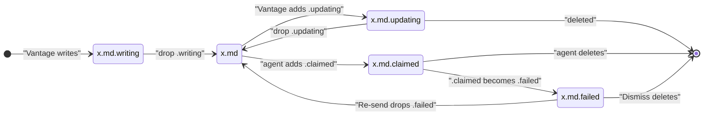

# The review outbox: sending comments to a watching agent

**Status:** design sketch, 2026-11-04, every question ruled the same day. Nothing is built. The rulings below came
out of one conversation with the maintainer and are recorded in the
[Decision Ledger](#decision-ledger). Claims about existing code were checked
against `main` at `01837a0`.

**The short version.** A review round has two trips. The trip back from the
agent is already a file: the agent writes to `.vantage/inbox/`, Vantage consumes
it, and the reply appears inline. The trip to the agent is still the
clipboard: the reviewer clicks Copy and pastes into the agent's session, and
because every paste has to teach a cold agent the protocol, it carries a lot of
boilerplate. This design makes the outgoing trip a file too. Vantage writes the
batch to `.vantage/outbox/`, and an agent that was told once to watch picks it
up within a second, answers through the inbox, and starts watching again.
Copy stays for agents that are not watching.

## 1. Why this fits the existing principles

The agent-facing principles were written for a clipboard channel, so each needs
checking against this one.

- **[P1](../reference/agent-cli.md#11-principles), the filesystem is the only
  channel.** It holds. The outbox is a directory of files, the mirror image of
  the inbox. There is no port, socket, RPC or MCP server, which
  [`agent-cli.md` §10](../reference/agent-cli.md#10-non-goals) rules out.
- **[P3](../reference/agent-cli.md#11-principles), no editing anyone's agent
  configuration.** It holds. The skill that starts watching is installed by the
  user ([§5](#5-starting-and-keeping-the-watch)); Vantage never writes it.
- **[P4](../design/agent-bootstrap.md#1-verdict-up-front), a human speaks
  first.** It holds. A human starts the watch, and a human clicks Send for every
  batch. Vantage never wakes an agent nobody pointed at it.
- **[P6](../design/agent-bootstrap.md#1-verdict-up-front), the payload is
  idempotent.** It holds. Every batch says the same thing, including the
  instruction to start watching again, and nothing asks whether the agent has
  seen a batch before.
- **The delivery-doors ruling**
  ([`review-state-architecture.md` §10](review-state-architecture.md#10-decisions-and-what-shipping-taught-us)):
  "copy/paste and file writes are the transfer mediums". It holds. The outbox
  is a file write, made by Vantage instead of the agent.

## 2. The parts

| Part | Written by | Read by | Purpose |
| :--- | :--- | :--- | :--- |
| `.vantage/outbox/` | Vantage | Agent | One file per batch of comments ([§4](#4-a-batchs-lifecycle)) |
| `.vantage/inbox/` | Agent | Vantage | Replies, unchanged from today |
| `.vantage/watching.md` | Vantage | Agent | How to watch, claim, answer and report a failure ([§5](#5-starting-and-keeping-the-watch)) |
| `.vantage/.gitignore` | Vantage | git | Contains `*`, so nothing under `.vantage/` is ever committed ([§7](#7-edge-cases-and-how-each-is-handled)) |
| The `vantage-watch` skill | The user installs it | Agent | Tells the agent to read `watching.md` and start watching |
| The Send button | Reviewer | Vantage | Writes the current document's unanswered comments as a batch |

Both directories use the same handoff the inbox already relies on: write the
file under a scratch name, then rename it to its final name. A rename within one
directory cannot be half done, so a file under its final name is complete.

## 3. One round



The wait asks whether a file exists, not whether something changed. A batch
sent while the agent is busy, or while no session is open, stays in the outbox,
and the next wait finds it at once. Nothing depends on the agent listening at
the moment a file appears.

## 4. A batch's lifecycle



A batch keeps one base name, `x.md`, for its whole life. Every other state is
that name with a suffix added, and every arrow except a delete is a rename that
adds, removes or swaps one suffix. Only the bare `x.md` matches the agent's
`*.md` wait, so a batch with any suffix never wakes an agent.

Vantage reads the state from the file name alone:

| In the outbox | Meaning | What the UI shows |
| :--- | :--- | :--- |
| `x.md` | Sent, nobody has picked it up | "Sent, not claimed yet", with the time sent, and Copy |
| `x.md.updating` | Vantage is rewriting an unclaimed batch | Nothing new; it lasts milliseconds |
| `x.md.claimed` | The agent has it | "Agent is working on this document", with the time since its last progress |
| `x.md.claimed`, past the timeout | The agent went quiet | "Agent picked this up but hasn't answered", with Re-send ([§6](#6-vantages-side)) |
| `x.md.failed` and `x.md.failed.reason` | The agent could not answer | The reason, with Re-send, Copy and Dismiss |
| Nothing, replies arrived | The round is done | The replies, inline |

"Not claimed yet" is a status, not a warning. The agent shares its session
with other work ([D3](#decision-ledger)), so a busy agent and an absent one
look the same to Vantage.

**One batch per document** ([D4](#decision-ledger)). A batch's name starts
with a time stamp so that a plain sort is oldest first, and then names the
document: `<unix-ms>-<flattened-doc-path>.md`, flattened the way the inbox and
the review store already flatten paths. A document can have several batches
waiting ([D1](#decision-ledger)), and the agent answers them in name order.

**What a batch contains.** The unanswered comments, as the Copy payload carries
them now. The browser assembles the text, with the code Copy already uses, and
posts it on Send ([OQ-RO2](#decision-ledger)). There is one implementation,
and the Go side only handles files. Three facts decided it:

- **Copy has to stay inside the click.** Over plain HTTP on a non-localhost
  address, the clipboard fallback only works during the user's gesture
  ([`clipboard.ts`](../../frontend/src/lib/clipboard.ts)), so Copy cannot wait
  for the server to send it text.
- **Part of the text belongs to `vantage-md`.** The payload includes its
  `ANSWER_PROCESSING_GUIDE`, which `vantage-check style-guide` also prints. Go
  would need a second copy of it.
- **An edit always comes from a browser.** A reviewer only edits or deletes a
  comment in a Vantage tab, which holds the review and the document, so it can
  post the rewritten text with the edit. A pointer to `watching.md` for the delivery format, in place of
the protocol text the paste repeats today. And last, so it is the last thing
the agent reads, the instruction to start watching again:

```markdown
When you have delivered, start this again in the background, then end your turn:
`sh .vantage/wait-for-batch.sh`
```

The wait is a script Vantage writes beside `watching.md` and rewrites at every
start. Two trials shaped it. Run as a one-line loop, it either wrote an error
every second under zsh, where a glob that matches nothing is the shell's own
error, or, once rewritten without a glob, could not be allowed by any
permission rule, because Claude Code cannot parse a pipe inside an `until`
condition and asked at every round. One plain command avoids both.

## 5. Starting and keeping the watch

**Starting.** The user installs a `vantage-watch` skill and runs it once per
session ([D5](#decision-ledger)). The skill stays thin: it tells the agent to
read `.vantage/watching.md` and follow it. The real instructions live in that
file because Vantage writes it and rewrites it at every start, so it always
describes the version that is running. Instructions kept in the skill would go
stale in every user's skill folder at each upgrade. The skill ships first as a
file in `userguide/` to copy; a Claude Code plugin can follow if the feature is
used.

**Keeping it.** A background command wakes the session once, when it exits. So
the wait is started again at the end of every round, and the instruction to do
that rides at the end of every batch ([D6](#decision-ledger)). The agent reads
it fresh each time, so a long turn or a context summary cannot drop it. There is
no timed fallback: a fallback slow enough to be cheap is too slow to help, and
the UI already shows an unclaimed batch within seconds.

**What `watching.md` tells the agent**, in order:

1. Check that this is the checkout Vantage serves; `watching.md` names it. If
   not, say so and stop ([§7](#7-edge-cases-and-how-each-is-handled), case 4).
2. Before waiting, handle every batch already in the outbox, oldest first.
3. On waking, **claim before reading**: rename `x.md` to `x.md.claimed`.
   - If the rename fails with "not found", another session or Vantage has it.
     Start the wait again.
   - If it fails for any other reason, stop watching and tell the user. A
     restarted wait would exit at once on the same file, forever.
4. Finish or park the current step of any other work first. Then change only the
   reviewed document, using targeted edits, never a whole-file rewrite. Re-read
   the file if an edit is refused because it changed on disk.
5. Check the document, deliver through the inbox, delete `x.md.claimed`.
6. If the batch cannot be answered, write `x.md.failed.reason` first, then rename
   `x.md.claimed` to `x.md.failed`, and say so in the conversation. Writing the
   reason first means Vantage never shows a failure with no explanation.
7. Say in the conversation that a review was handled, then start the wait again
   and end the turn. Keep the review's edits out of any commit for other work.

**The permissions a round needs.** The wait, the renames and deletes under
`.vantage/`, editing the document, `uvx vantage-check`, and writing the inbox.
The skill's setup instructions list them to allow ahead of time, so a round
does not stop at a prompt while the user is away ([§7](#7-edge-cases-and-how-each-is-handled), case 3).

## 6. Vantage's side

- **Send** writes the current document's unanswered comments as a new batch. It
  writes nothing when there are none.
- **Editing or deleting a sent comment** sends the batch's new text from the
  browser with the edit. The server first claims the unclaimed batch by
  renaming `x.md` to `x.md.updating`, then rewrites it, or removes it if no
  comments are left. If the rename fails, the agent already has the batch, so
  an edit goes out as a new batch holding only that comment, and a deletion
  sends nothing: the agent's reply to a deleted comment is rejected as "no
  comment", as it is today ([D2](#decision-ledger)).
- **Re-send** renames `x.md.failed` or a stale `x.md.claimed` back to `x.md` and
  deletes any reason file. **Dismiss** deletes both. Vantage never re-queues a
  batch on its own ([D7](#decision-ledger)).
- **A claim is stalled after 15 minutes without progress**
  ([OQ-RO1](#decision-ledger)). Progress is the claim itself or any inbox
  delivery for that document, so a large batch answered in several deliveries
  is never flagged while it keeps delivering. The timeout only changes the
  label: the time since the last progress is always shown, so a reviewer who
  knows the session is gone can act sooner. Failures the agent can detect are
  reported at once ([D9](#decision-ledger)), so the timeout only has to catch
  silent ones, and a late flag costs little. It is not configurable until
  someone needs it to be.
- **The watcher must watch the outbox.** On `main` it prunes everything under
  `.vantage` except the inbox ([`watcher.go`](../../internal/live/watcher.go#L112-L118)), so it would
  never see a claim.
- **`.vantage/.gitignore`** with `*` is written the first time the outbox is
  created. It ignores itself too, so the user's repository shows no change
  ([D8](#decision-ledger)).

## 7. Edge cases and how each is handled

1. **A rewrite races a claim.** Checking "is it unclaimed?" and then renaming a
   new version over `x.md` leaves a gap: if the agent claims in between, the
   rename creates a second batch and every comment is answered twice. Vantage
   claims the file with its own rename instead. Whichever rename of `x.md` runs
   first owns the file, for Vantage and for agents alike.
2. **A batch the agent cannot answer** (the document was moved or deleted, the
   file is malformed, the agent cannot write) would wake the agent every turn
   if left as `x.md`. Claiming before reading means a bad batch wakes it once,
   and reporting the failure tells the reviewer why within a second.
3. **A permission prompt stops a round** with the batch claimed and the user
   away. The skill lists the permissions to allow ([§5](#5-starting-and-keeping-the-watch)).
4. **The agent watches the wrong checkout**, such as another worktree of the
   same repository. It never claims anything and the UI shows "not claimed
   yet". `watching.md` names the served checkout and the agent checks it first.
5. **Outbox files committed by accident.** Unlikely, since it needs a broad
   `git add` while a batch is waiting, but review comments in a pushed history
   are awkward to remove. `.vantage/.gitignore` closes it.
6. **Two sessions watch one repository.** The claim rule means only one
   answers, but it may be the one that has never seen the document. The skill
   says to run one watching session per repository.
7. **A follow-up while the agent works.** It becomes a new batch. Round numbers
   already keep a follow-up apart from what the first reply answered.
8. **Send while a batch is claimed repeats its comments.** Found in the first
   live trial, 2026-11-04. Send includes every comment still waiting on the
   agent, and the comments in a claimed batch are still waiting until the
   replies land. A reviewer who clicked Send while the bar said Working queued
   the same comment again, and only the agent noticing kept it from being
   answered twice. Send must leave out the comments a claimed batch already
   holds, at the round it holds them, so a new batch carries only new comments
   and new follow-ups. Until then, `watching.md` tells the agent to skip a
   comment it has already answered at that round.
9. **A round stops at a permission prompt nobody is there to answer.** Found by
   the agent evals, 2026-11-05 (`just agent-eval`). A permission rule matches a
   plain command, and agents chain them: `cd … && mv …`, `; echo $?`, and the
   one-line delivery command the batch itself shows. In Claude Code's standard
   permission mode each of those asks, and the round waits for the user. Two
   changes closed it in the evals: the wait is a script Vantage writes, so it
   is one plain command, and `watching.md` tells the agent to run one plain
   command at a time and to deliver with its file-writing tool and `mv`. With
   both, a three-round interactive session ran with no prompt at all.
10. **Asked to watch before anything was sent, the agent finds no guide.**
   Found by the same evals. `watching.md` is written by the first Send, or at
   startup where `.vantage/` already exists, so a repository nobody has
   reviewed has none, and the agent, told to read it, rightly stops. Starting
   the watch before reviewing is the natural order, so this is open: Vantage
   could write the guide for every repository it serves, or the skill could
   carry the wait command as a fallback.

## 8. Known gaps

- **Hand edits during a claimed batch get credited to the agent.** A reply's
  "after" is read from disk when the delivery arrives
  ([`commands.go`](../../internal/review/commands.go#L371)), so anything saved between the
  agent's edit and its delivery shows in the reply's diff. This is true of
  copy and paste today; the busy banner is the mitigation.
- **A wake-up from idle works; one during a busy turn is still unmeasured.**
  The interactive eval saw an idle session claim a batch 7 seconds after Send,
  and a Send made while the agent worked was answered in the same session.
  Whether that second wake arrived between tool calls or after the turn ended
  was not measured. Either is acceptable ([D3](#decision-ledger)); it only
  changes the delay.
- **A headless session cannot be woken.** `claude -p` ends with its turn, so
  the headless evals check that the wait was restarted, not that it wakes
  anything. The interactive eval covers waking.
- **Only agents with background commands can watch.** Any other agent, and a
  chat model with no tools, keeps using Copy.

## 9. What to build, in order

1. Vantage writes `watching.md` and `.vantage/.gitignore`, and the watcher sees
   the outbox.
2. Send posts the browser's text and Vantage writes a batch; the outbox states
   show in the review panel.
3. The `vantage-watch` skill in `userguide/`, with its permission list.
4. Rewrite-by-claim for edited and deleted comments, and Send leaving out
   what a claimed batch holds ([§7](#7-edge-cases-and-how-each-is-handled),
   case 8).
5. Failure reports, Re-send and Dismiss.
6. The stalled-claim timeout ([§6](#6-vantages-side)).

## Decision Ledger

| ID | Ruling / Decision | Date | Settled in |
| :--- | :--- | :--- | :--- |
| D1 | A Send while a batch is claimed writes a new batch; nothing is appended to a claimed one | 2026-11-04 | [§4](#4-a-batchs-lifecycle) |
| D2 | An edit or deletion rewrites an unclaimed batch; once claimed, an edit goes out as a new batch | 2026-11-04 | [§6](#6-vantages-side) |
| D3 | The watching agent shares its session with other work; delay behind that work is accepted, so the UI says "not claimed yet", never "nobody is watching" | 2026-11-04 | [§4](#4-a-batchs-lifecycle), [§5](#5-starting-and-keeping-the-watch) |
| D4 | One batch per document | 2026-11-04 | [§4](#4-a-batchs-lifecycle) |
| D5 | The first wait is started by a user-installed skill; Vantage writes the instructions it points at | 2026-11-04 | [§5](#5-starting-and-keeping-the-watch) |
| D6 | The instruction to restart the wait rides at the end of every batch; no timed fallback | 2026-11-04 | [§5](#5-starting-and-keeping-the-watch) |
| D7 | A stalled claim is reported, and only the reviewer re-queues it | 2026-11-04 | [§6](#6-vantages-side) |
| D8 | Vantage writes `.vantage/.gitignore` containing `*` | 2026-11-04 | [§6](#6-vantages-side) |
| D9 | The agent claims before reading and reports a failure as `.failed` with a reason file | 2026-11-04 | [§5](#5-starting-and-keeping-the-watch), [§7](#7-edge-cases-and-how-each-is-handled) |
| OQ-RO1 | A claim is stalled after 15 minutes without progress, where progress is the claim or any inbox delivery for the document; the elapsed time is always shown; not configurable | 2026-11-04 | [§6](#6-vantages-side) |
| OQ-RO2 | A batch's text is assembled in the browser by the code Copy uses, and posted on Send and on every edit of a sent comment; the server only handles files. Amended the same day: an earlier ruling for Go missed the clipboard and `vantage-md` constraints | 2026-11-04 | [§4](#4-a-batchs-lifecycle) |
